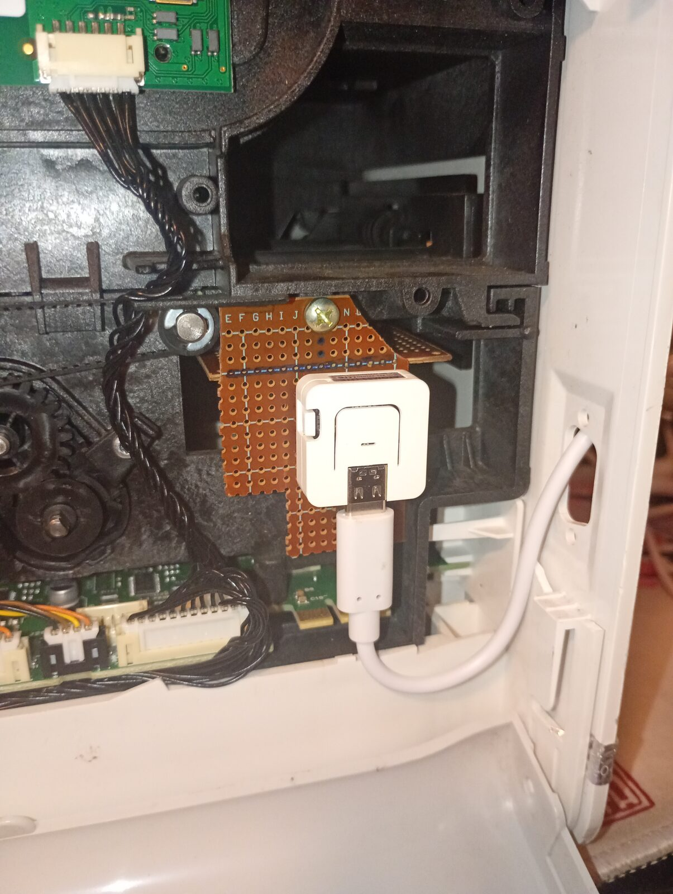
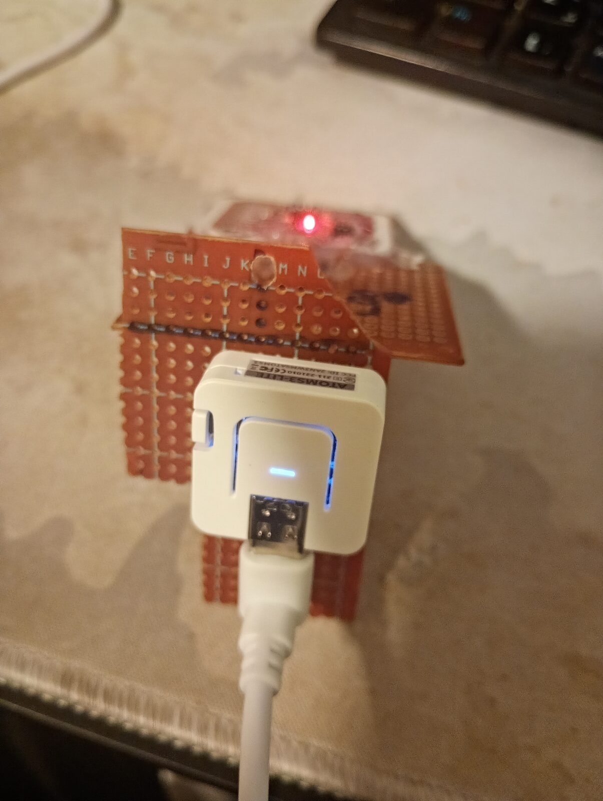
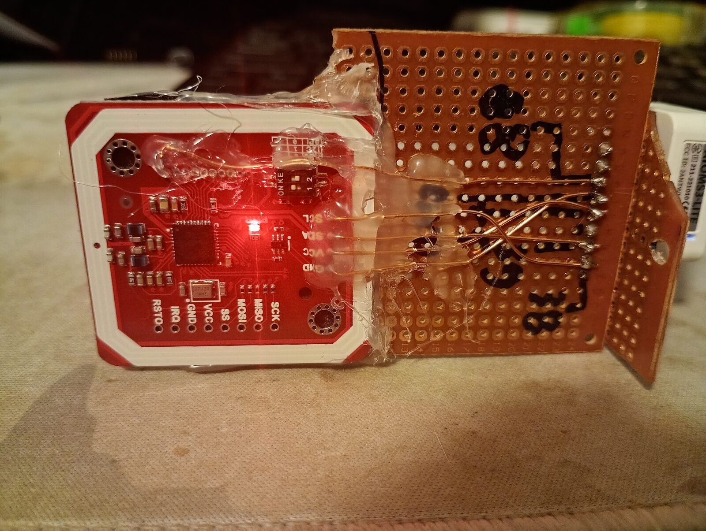
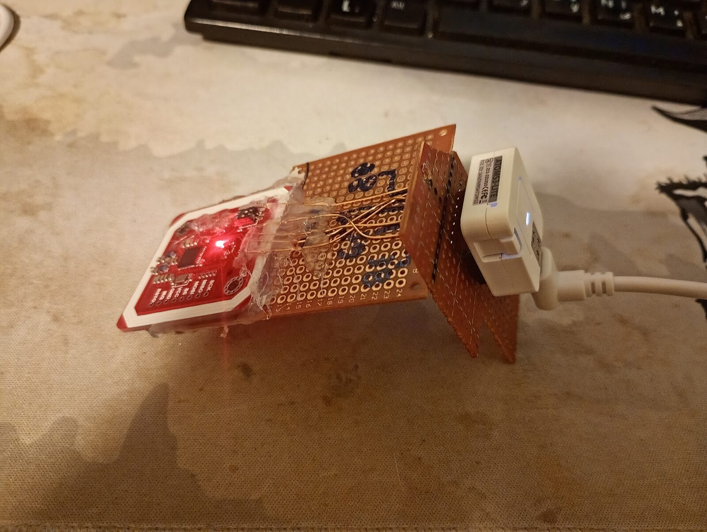

# Fitting an NFC reader into an Evolis Primacy

A card reader that lives inside the printer, at the contactless station, and
serves the UID of whatever card is parked there over the LAN. This document is
how the hardware goes in and how it is used; the firmware's own HTTP API and its
limits are in [`README.md`](README.md).

## Why build one

Evolis sells contactless readers for the Primacy, and they are all USB. The
vendor-intended way to mount one is a pair of parts:

| Part                          | What it is                                                          |
| ----------------------------- | ------------------------------------------------------------------- |
| `CP010047` COUPLER LINK BOARD | internal coupler board, carries a Molex USB port inside the printer |
| `CI010606` ANTENNA SUPPORT    | the bracket the vendor NFC board clips into, at the station         |

Both are worth buying if you have them: the antenna support is the mechanical
retention, and the Molex port is the 5 V feed. The catch is the interface - a
USB encoder is only useful on a printer that does USB-over-IP. A base model
Primacy does not, and over Ethernet the encoders are simply not reachable: the
encoder modules hang off the printer's internal USB hub, whose upstream port is
the printer's USB type-B, and nothing about them is served on the network
channel (TCP 80 and 9100 only).

So the DIY route is a reader that speaks HTTP itself: an **M5Stack AtomS3 Lite**
and a **PN532** are both compact and cheap, and a bit of perfboard makes the
mount.

### What the vendor install looks like

Card Integrators has a picture walkthrough of fitting the stock RFID board:
["Evolis Primacy: Locate and Secure the RFID
Board"](https://support.cardintegrators.com/support/solutions/articles/72000581894-evolis-primacy-locate-and-secure-the-rfid-board).

It is worth reading before you open the printer at all, because it is the same
panel and the same slot this reader goes into. The photos in this document pick
up where that walkthrough stops: at what goes _in_ the slot.



## Parts

- M5Stack AtomS3 Lite (ESP32-S3, USB-C, WS2812C on GPIO35)
- PN532 breakout, 13.56 MHz, on I2C - DIP switches **SEL0 ON, SEL1 OFF** = I2C,
  address `0x24`
- a small perfboard with screw holes, and pin headers
- hot glue, generously
- 5 jumper wires, and a USB-C cable to power it

The AtomS3 Lite has no 5 V available inside a base Primacy, so the power cable
does not come from the printer at all: it leaves through the back of the machine
and is fed from outside. Route it to a machine or hub you can reach rather than
a bare charger - that same USB-C lead is the flashing and logging port
(USB-Serial-JTAG), so a reader reachable over USB can be reflashed and watched
without opening the printer again.



## Wiring

Five wires, all on the 8-pin header:

| PN532  | AtomS3 Lite | note                                   |
| ------ | ----------- | -------------------------------------- |
| SDA    | G39         |                                        |
| SCL    | G38         |                                        |
| RSTPDN | G8          | optional, but wired here - see below   |
| VCC    | 5V          | **not** 3V3; the field range wants 5 V |
| GND    | GND         |                                        |

Pin numbers are the ones the firmware is built with (`src/main.rs`,
`board-atoms3lite`); the code, not this table, is what the device actually
reads. Only four signals are logically required - there is no IRQ line, which is
why the driver polls the chip's status byte instead of waiting on an interrupt.

I2C runs at 100 kHz. The PN532 is specified to 400 kHz but its timing is sloppy,
and 100 kHz is what works on every breakout so far; raise it only if poll rate
matters more than reliability.

Wire **RSTPDN** (an input on the module), never RSTO. With G8 wired the firmware
drives the chip itself: a 100 ms pulse at boot, a pulse after three failed init
attempts in a row, and one on demand from `GET /nfc/reset`. That last one is the
real recovery - a PN532 caught mid-transaction by an ESP32 reset holds a bus
line low, and no amount of retrying clears it. It is also what makes flashing
need no preparation. Set it in `.env`:

```
PN532_RESET_PIN=8
```

Without that line the firmware still retries and reports honestly, but a stuck
chip needs someone to power-cycle it, and the reader has to be parked before
every flash.

## Mounting

Small perfboard with screw holes, fixed inside where the encoder module would
sit. The Atom plugs onto pin headers soldered into it - those headers are both
the electrical connection and the mechanical one, so the Atom sits on the
carrier held by its own pins. The PN532 is attached at a right angle on the same
carrier, so its coil faces the card path, and then copious amounts of hot glue
hold the whole thing together.





## Firmware

```sh
nix develop            # rustup + espflash + gcc, sources ~/export-esp.sh
cp .env.example .env
$EDITOR .env
cargo run --release    # builds, flashes and attaches the monitor
```

`.env` for this build:

```
WIFI_SSID=…
WIFI_PASSWORD=…
MDNS_HOSTNAME=nfc-reader     # http://nfc-reader.local
PN532_RESET_PIN=8
```

All four are baked in at build time, so pick the mDNS name you want to curl
now - changing it later means a reflash. `.cargo/config.toml` already sets the
target and the `espflash` runner, so plain `cargo run --release` is the whole
build-flash-monitor cycle; for the ESP32 DevKit testbed see `README.md`.

Without Wi-Fi credentials the firmware still runs and logs, reader only, no
network - that is the way to bring the PN532 up before touching the LAN.

## Using it

### On the bench

The LED says the state at a glance: green while a card is present, dim white
while RF is on and nothing is there, amber during a REST-triggered exchange, red
blinking on a fault, off when RF is off. `/nfc/status` reports the same state as
text plus the chip's firmware version, the poll counters and `last_poll_ms`.

```sh
curl -s http://nfc-reader.local/nfc/status              # everything, start here
curl -s 'http://nfc-reader.local/nfc/uid?wait_ms=3000'  # hold until a card appears
curl -s http://nfc-reader.local/nfc/card                # UID + kind/sak/atqa
curl -s http://nfc-reader.local/nfc/ndef                # what is written on the card
curl -s 'http://nfc-reader.local/nfc/write?url=https%3A%2F%2Fexample.org%2Fhello'
```

`uid` is the dashed hex form (`04-A2-B3-C4`); `uid_decimal` is the same four
bytes as 12 decimal digits (`004162179196`), one `%03d` per UID byte. Two
spellings of one UID - take whichever your application stores straight out of
the response rather than re-encoding it.

### From the Evolis SDK

The same sequence by hand, when driving the printer yourself:

```python
import evolis, requests

co = evolis.Connection()
co.open("socket://192.168.2.101?type=evolis")   # your printer

co.set_card_pos(evolis.CardPos.CONTACTLESS)     # park the card under the coil
uid = requests.get("http://nfc-reader.local/nfc/card?wait_ms=3000",
                   timeout=5).json()["uid_decimal"]
# the print session then takes the card on from that station
```

`CardPos.CONTACTLESS` is what puts the card where the reader can see it.

## When it does not come up

The reader has to answer its first I2C access at boot. If it does not, init
retries every 5 s (`no PN532 on the I2C bus yet`) and `/nfc/status` reports
`state:"failed"` with the reason.

| Symptom                           | What it is                                                                                                                                                                                                               |
| --------------------------------- | ------------------------------------------------------------------------------------------------------------------------------------------------------------------------------------------------------------------------ |
| `I2C bus error (no status byte…)` | the bus itself did not complete - a line held low, typically a chip caught mid-transaction by a flash reset. With RSTPDN wired, `GET /nfc/reset`; without it, power-cycle the module (esp-hal 1.2.2 has no bus recovery) |
| `malformed response frame`        | the log prints the raw bytes it rejected - the fastest way in                                                                                                                                                            |
| reader up, no card ever seen      | the coil is not where the card is, or the steel around it is eating the field. A card at the station with the LED still dim white means mechanics, not wiring                                                            |
| nothing on the LAN                | mDNS name baked at build time; the IP is in the boot log and in `/nfc/status`                                                                                                                                            |
